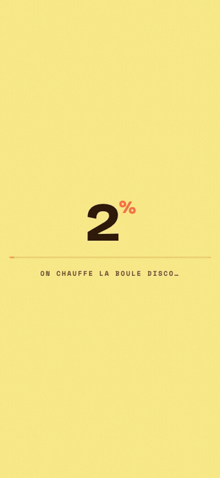
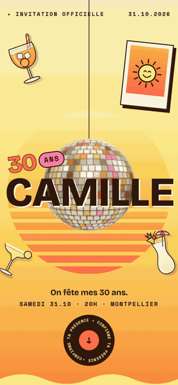
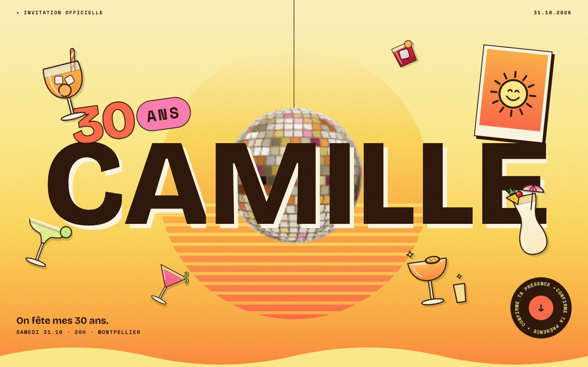
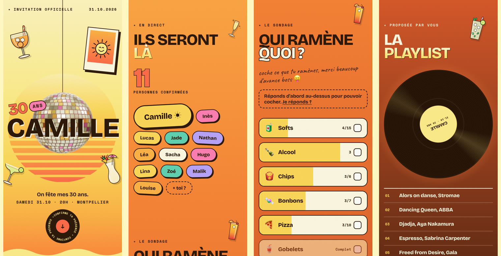
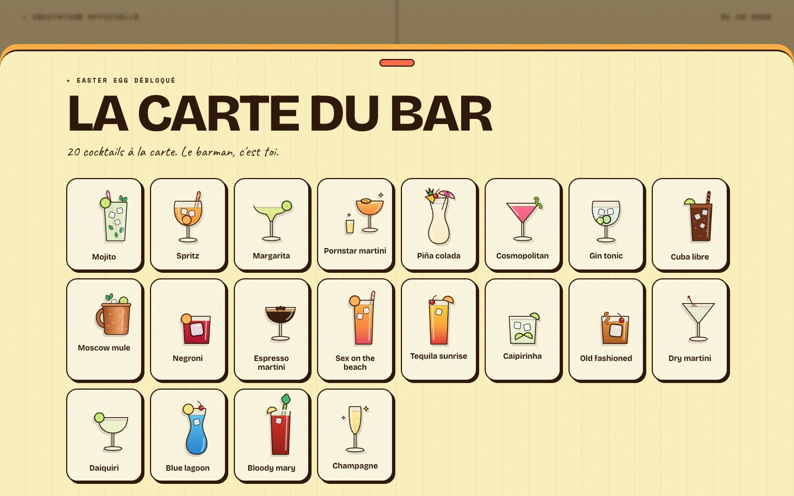
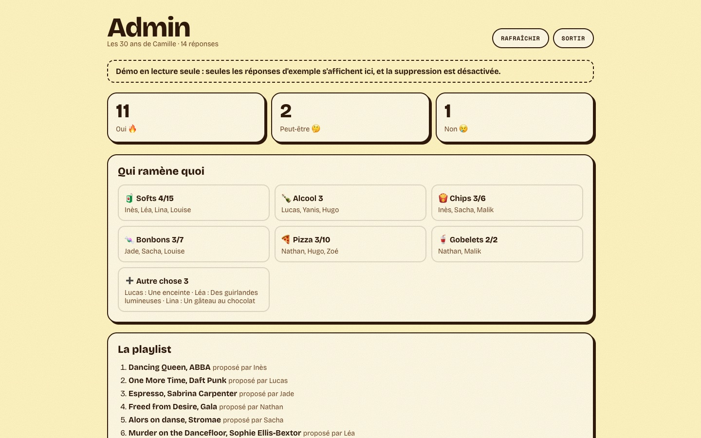

# rsvp-party

Un site d'invitation animé pour une fête. Les invités répondent, voient qui vient, disent ce qu'ils ramènent et remplissent la playlist, le tout en direct, depuis leur téléphone.

**[Voir la démo →](https://rsvp-party-demo.vercel.app)** · un anniversaire fictif, à ouvrir de préférence sur téléphone. L'admin est sur [/admin](https://rsvp-party-demo.vercel.app/admin), mot de passe `demo`.

<p align="center">
  
  &nbsp;&nbsp;
  
</p>



## Ce que ça fait

- **Répondre en 10 secondes** : prénom, oui / peut-être / non. Confettis, et la pastille du prénom vole jusqu'à la liste des invités.
- **Ils seront là** : la liste des confirmés, mise à jour en direct.
- **Qui ramène quoi** : chacun coche ce qu'il apporte, avec une limite par truc (6 paquets de chips, pas 12) et jusqu'à 3 « autre chose » en texte libre.
- **La playlist** : chacun propose ses sons, la liste reste anonyme.
- **L'adresse protégée** : elle ne s'affiche qu'une fois la venue confirmée. Un lien WhatsApp circule vite.
- **L'agenda** : ajout à l'agenda adapté à l'appareil (iPhone, Android, ordinateur).
- **L'admin** : qui vient, qui ramène quoi, qui a proposé quel son.
- **Les effets pour le pouce** : soleil qui se couche au scroll, boule disco 3D qui suit l'inclinaison du téléphone, pluie de cocktails quand on le secoue, tiroir caché à tirer au doigt.



<table>
  <tr>
    <td></td>
    <td></td>
  </tr>
  <tr>
    <td align="center">L'easter egg : un tap sur un cocktail ouvre la carte du bar</td>
    <td align="center">L'admin des organisateurs</td>
  </tr>
</table>

## Crée ton événement en 5 étapes

Il faut un compte [Vercel](https://vercel.com) (gratuit) et son outil en ligne de commande : `npm i -g vercel`.

**1. Récupère le code**

Clique sur **Use this template** en haut de cette page, puis clone ton nouveau repo.

```bash
npm install
```

**2. Décris ta fête dans [`src/event.config.ts`](src/event.config.ts)**

Prénom, date, lieu, sections affichées, dress code, ce que les invités peuvent ramener, textes. Chaque réglage est expliqué dans [`src/config/schema.ts`](src/config/schema.ts), et l'éditeur signale les erreurs de saisie.

**3. Crée le site et sa base de données**

```bash
vercel link
vercel integration add neon
```

Ouvre ensuite la base dans la console Neon (onglet *SQL Editor*) et colle le contenu de [`db/schema.sql`](db/schema.sql).

**4. Ajoute les infos secrètes**

```bash
vercel env add ADMIN_PASSWORD
vercel env add EVENT_ADDRESS
vercel env add NEXT_PUBLIC_SITE_URL
```

Le mot de passe de l'admin, l'adresse exacte (affichée seulement aux invités qui ont répondu) et l'adresse publique du site. Récupère-les en local avec `vercel env pull .env.local` (le modèle est dans [`.env.example`](.env.example)).

**5. Mets en ligne**

```bash
vercel deploy --prod
```

Partage le lien, suis les réponses sur `/admin`. Pour l'image d'aperçu du lien (WhatsApp, Messages), lance `npm run dev`, ouvre `/og-preview`, fais une capture de 1080 × 1080 et enregistre-la en JPEG dans `public/apercu.jpg`.

## Configurer

| Réglage | Ce qu'il fait |
|---|---|
| `name`, `badge`, `title`, `description` | Le grand titre, la pastille (« 30 ans »), le titre de l'onglet et de l'agenda |
| `date` | Début, fin et fuseau : le compte à rebours, l'agenda et toutes les dates affichées en découlent |
| `place` | Le lieu et la ville. L'adresse exacte vit dans la variable `EVENT_ADDRESS` et s'affiche après une réponse (`after-rsvp`) ou tout de suite (`always`) |
| `theme` | L'univers visuel (voir plus bas) |
| `photos` | Une photo pour le premier écran et une à côté du formulaire, ou des illustrations |
| `sections` | Les blocs affichés : compte à rebours, infos, réponse, invités, sondage, playlist |
| `dresscode` | La carte « Dress code », ou `null` pour la masquer |
| `poll` | Ce que les invités ramènent, avec une limite par truc, et le nombre de propositions « autre chose » |
| `playlist` | Le nombre de sons proposés par personne |
| `easterEgg` | Le tiroir caché qui s'ouvre au tap sur les illustrations |
| `texts` | Les phrases propres à l'événement (accroche, remerciements, fin…) |

Les sections invités, sondage et playlist ont besoin de la section réponse. Sans réponse, pas besoin de base de données : le site devient une simple invitation.

## Les thèmes

L'univers visuel vient d'un thème. Thème disponible : **`disco`** pour un anniversaire (soleil couchant, boule disco, cocktails, nuit étoilée, ton tutoyé et festif).

Un thème vit dans `src/themes/<nom>/` et fournit, selon le contrat de [`src/themes/types.ts`](src/themes/types.ts) :

- **les couleurs**, sous des noms neutres (`ink`, `paper`, `brand`, `accent`…), et la rampe du ciel des sections ;
- **les polices** ;
- **le premier écran** (chargement compris) et une **animation signature** au scroll ;
- **le décor** des sections, l'illustration du dress code et celle qui remplace la photo ;
- **l'easter egg** : le contenu du tiroir caché ;
- **tous les textes communs**, dans la voix du thème (le tutoiement d'un anniversaire, le vouvoiement d'un mariage).

Le reste (sections, réponses en direct, sondage, playlist, admin, API) est commun à tous les thèmes.

**Créer un thème :** copier `src/themes/disco`, l'adapter, l'ajouter dans [`src/themes/index.ts`](src/themes/index.ts) et dans le type `theme` de [`src/config/schema.ts`](src/config/schema.ts).

## La démarche

Le projet est né d'une vraie invitation d'anniversaire, avant de devenir un modèle réutilisable. Les choix viennent de là.

- **Le téléphone d'abord.** Le lien circule sur WhatsApp, presque tout le monde l'ouvre sur un téléphone. Pas de survol : les effets réagissent au pouce, au scroll, à l'inclinaison et à la secousse. Le défilement doux jusqu'au formulaire a été repris pour Safari sur iPhone, qui l'interrompait.
- **Un récit plutôt qu'une page.** Le fond suit un coucher de soleil : jaune en haut, orange au milieu, nuit étoilée à la fin. Le ciel se recalcule selon les sections actives, pour que le dégradé reste continu.
- **La vie privée par défaut.** L'adresse n'est envoyée qu'aux invités qui ont répondu, la playlist ne dit pas qui a proposé quoi, et les prénoms du sondage restent dans l'admin.
- **Léger malgré la 3D.** Les polices sont réduites à ce qui sert (de 221 à 99 ko), la 3D se charge pendant l'écran de chargement et ne tourne que lorsqu'elle est à l'écran, et le tiroir caché n'est construit qu'à la première ouverture.
- **Accessible.** Les animations s'arrêtent avec le réglage « réduire les animations », les décors sont ignorés par les lecteurs d'écran, et la boule disco a une version CSS si WebGL n'est pas disponible.
- **Une vitrine sans risque.** En mode démo, chaque visiteur peut tout essayer sans voir ce que tapent les autres.

## Mode démo

Avec la variable `DEMO_MODE=1` :

- les réponses d'exemple de [`db/seed-demo.sql`](db/seed-demo.sql) sont visibles par tout le monde ;
- chaque visiteur peut répondre, cocher et proposer des sons, mais ne voit que ses propres ajouts ;
- les ajouts des visiteurs s'effacent au bout de 2 jours ;
- l'admin ne montre que les réponses d'exemple, en lecture seule.

## Stack

[Next.js](https://nextjs.org) · [GSAP](https://gsap.com) pour les animations · [Three.js](https://threejs.org) pour la boule disco · Postgres sur [Neon](https://neon.tech) · [Vercel](https://vercel.com)

```
src/
├── event.config.ts      la fête (le seul fichier à modifier)
├── config/schema.ts     le format de la configuration, documenté
├── themes/              les univers visuels (disco)
├── components/          sections, tiroir, effets communs
├── app/                 pages, admin et API
└── server/              base de données, adresse, mode démo
db/                      schéma et réponses de démo
```

## Licence

[MIT](LICENSE). Conçu par [@gowya](https://github.com/gowya).
